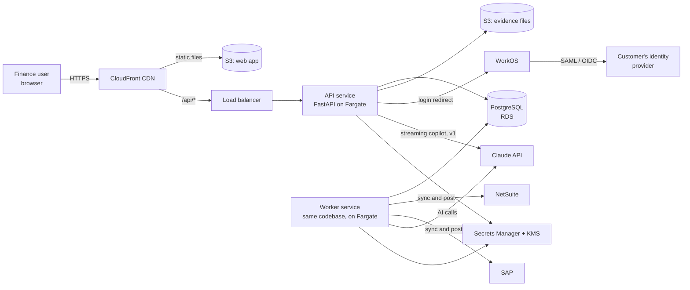
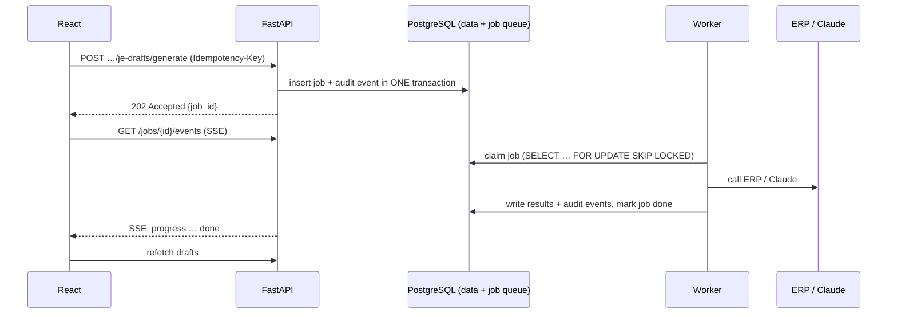
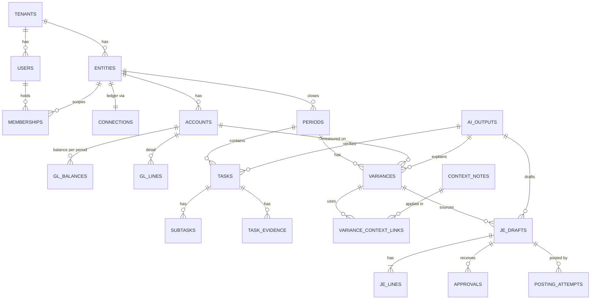
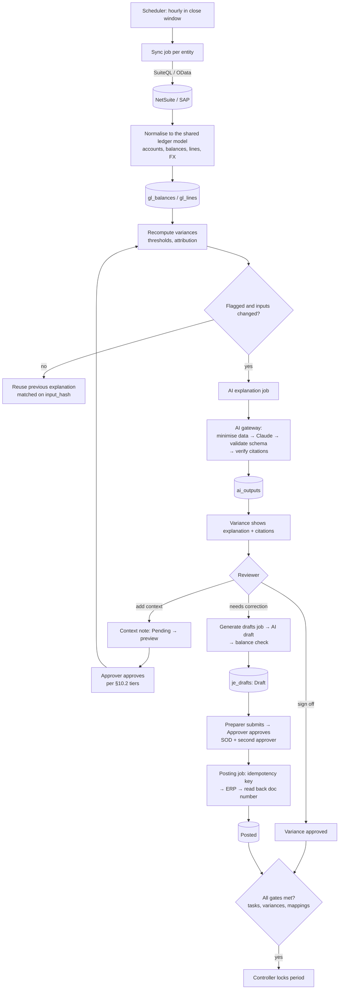

# Architecture: Continuous Close Hub

| | |
|---|---|
| **Status** | Proposed v1.0. Design only; no code yet |
| **Date** | 15 Nov 2026 |
| **Based on** | [PRD.md](PRD.md) v2.0 and [TECH-STACK.md](TECH-STACK.md) v1.0 |
| **Scope** | The MVP (PRD §9), with extension points for the v1 modules |

**Assumptions** (the tech stack decisions still open in TECH-STACK §11):
- **D-2:** background jobs use a **Postgres-backed queue**. If Celery is chosen instead, §3.3 and §7 change, but nothing else does.
- **D-3:** the identity provider is **WorkOS**. Any OIDC or SAML broker fits the same flow in §6.
- **D-4:** the SAP adapter is designed to be swappable (OData for S/4HANA, RFC/BAPI for ECC) until PRD question Q2 is answered.

---

## 1. System context



**Key points:**
- **Two runtime services, one codebase.** The **API** serves user requests. The **worker** runs everything slow or external: ERP syncs, AI batch runs and ERP posting. Users never wait on an ERP or a model call, except for streamed copilot answers in v1.
- **Postgres is the system of record** for application data, the audit log and the job queue.
- **Only the worker talks to ERPs.** The API can enqueue a posting, but it never holds posting credentials in a request path.

---

## 2. Project structure

One monorepo, so that the API schema, the generated client and the evals change together in one pull request.

```
continuous-close-hub/
├── apps/
│   ├── web/                         # React + TypeScript (Vite) single-page app
│   │   └── src/
│   │       ├── app/                 # router, providers, layout, error boundaries
│   │       ├── features/            # one folder per product area
│   │       │   ├── setup/           # connect ERPs, account mapping, thresholds (E1)
│   │       │   ├── close-status/    # entity cards, roll-up, close health (F2)
│   │       │   ├── checklist/       # tasks, subtasks, evidence, sign-off (F3)
│   │       │   ├── flux/            # variance tree, explanation drawer (F4)
│   │       │   ├── ai-context/      # propose / approve / retire context (F5)
│   │       │   ├── journals/        # drafts, review, batch approve, posting status (F6)
│   │       │   └── audit/           # trace view, exports (F7)
│   │       └── shared/
│   │           ├── api/             # generated typed client (do not hand-edit)
│   │           ├── ui/              # shadcn/ui components
│   │           └── lib/             # money formatting, dates, permissions helpers
│   │
│   └── api/                         # Python 3.12 + FastAPI. Also the worker entrypoint
│       ├── app/
│       │   ├── main.py              # API entrypoint
│       │   ├── worker.py            # worker entrypoint (same code, different process)
│       │   ├── core/                # config, db session, tenancy context, auth,
│       │   │                        # idempotency, errors, logging, telemetry
│       │   ├── modules/             # one folder per domain module (see table below)
│       │   │   ├── tenancy/
│       │   │   ├── brain/
│       │   │   ├── close/
│       │   │   ├── flux/
│       │   │   ├── journals/
│       │   │   ├── ai/
│       │   │   └── audit/
│       │   └── connectors/
│       │       ├── base.py          # shared ledger interface
│       │       ├── netsuite/        # SuiteTalk REST + SuiteQL adapter
│       │       └── sap/             # OData (S/4HANA) or RFC/BAPI (ECC) adapter, per Q2
│       ├── migrations/              # Alembic schema migrations
│       └── tests/
│           ├── unit/
│           ├── integration/         # real Postgres via Testcontainers
│           ├── properties/          # Hypothesis accounting invariants
│           └── contracts/           # recorded ERP responses + sandbox contract tests
│
├── packages/
│   └── api-client/                  # TypeScript client generated from OpenAPI
├── evals/                           # AI golden sets and scoring (PRD §10 item 4)
├── e2e/                             # Playwright + axe-core end-to-end tests
├── infra/
│   └── terraform/
│       ├── modules/                 # network, rds, ecs, s3, cloudfront, secrets
│       └── envs/                    # dev, staging, prod
├── prototype/                       # the current demo, kept for reference only
├── docs/                            # PRD, TECH-STACK, ARCHITECTURE, ADRs
└── .github/workflows/               # CI: lint → test → evals → e2e → scan → deploy
```

### 2.1 Inside each backend module

Every module under `app/modules/` has the same layout:

| File | Responsibility |
|---|---|
| `router.py` | HTTP endpoints only: parse input, call the service, return output. No business logic |
| `schemas.py` | Pydantic request and response models. These feed the OpenAPI spec |
| `service.py` | Business rules: SOD, state transitions, thresholds. Writes audit events |
| `repository.py` | Database queries (SQLAlchemy). The tenant is always taken from the session context |
| `models.py` | SQLAlchemy table definitions |
| `jobs.py` | Background job handlers for this module |

### 2.2 Module responsibilities and dependency rules

| Module | Owns | May call |
|---|---|---|
| `tenancy` | Tenants, entities, users, memberships, roles | `audit` |
| `brain` | Connections, sync runs, chart of accounts, mappings, balances, FX rates | `tenancy`, `audit`, `connectors` |
| `close` | Periods, checklist, tasks, evidence, comments, lock and reopen | `tenancy`, `brain`, `ai`, `audit` |
| `flux` | Thresholds, variances, attributions, AI context notes | `brain`, `close`, `ai`, `audit` |
| `journals` | Drafts, lines, approvals, posting attempts | `flux`, `close`, `brain`, `ai`, `audit`, `connectors` |
| `ai` | Model gateway, prompts, output validation, AI audit records | `audit` only. **It never calls other modules or writes their data** |
| `audit` | The append-only event log and exports | none |

**Rules:**
- Modules call each other **only through `service.py`**, never by querying another module's tables. This keeps a later split into separate services possible.
- **`ai` returns proposals and never acts on them.** The calling module decides what to store, always as a draft or pending item. This is the PRD's "preparer, never approver" rule built into the code structure.
- **Only `journals` can trigger an ERP write**, and only from the `Approved` state.

---

## 3. Frontend/backend flow

### 3.1 Request lifecycle (synchronous)

```mermaid
sequenceDiagram
    participant UI as React (feature)
    participant Q as TanStack Query
    participant C as Generated API client
    participant API as FastAPI
    participant DB as PostgreSQL

    UI->>Q: user action / screen load
    Q->>C: typed call
    C->>API: HTTPS + session cookie (+ CSRF header, + Idempotency-Key on writes)
    Note over API: Middleware chain:<br/>1 request ID + tracing<br/>2 authenticate session<br/>3 load tenant + memberships<br/>4 rate limit<br/>5 idempotency check (writes)
    API->>DB: BEGIN; SET LOCAL app.tenant_id = …
    API->>API: router → service: authorize role + SOD, apply rules
    API->>DB: read/write via repository (RLS filters every row)
    API->>DB: INSERT audit event (same transaction)
    API->>DB: COMMIT
    API-->>C: JSON response (or RFC 9457 problem details)
    C-->>Q: typed result
    Q-->>UI: render; invalidate related queries
```

### 3.2 Frontend rules

| Concern | Approach |
|---|---|
| **Server data** | Comes only from TanStack Query. Query keys include the entity and period, so switching entity never shows another entity's cached data |
| **Financial actions** (approve, post, lock, sign off) | **Pessimistic updates**: the UI waits for the server to confirm. It never shows "approved" before it is approved. Other edits, such as subtask checkboxes and comments, can update optimistically |
| **Permissions in the UI** | Buttons are hidden or disabled based on the permissions returned by `GET /me`. **The server always re-checks**; the UI's checks are for convenience, not security |
| **Filters and selection** | Kept in the URL (entity, period, filters), so views are shareable and survive a refresh |
| **AI text** | Rendered as plain text or sanitised Markdown. Never as raw HTML (see risk S-7) |
| **Freshness** | Every AI output shows the data's last-sync time (EB-4) |

### 3.3 Long-running work (asynchronous)

Anything that calls an ERP or runs AI across many records is a **job**: syncs, generating explanations, generating drafts, posting and exports.



Because the job is created in the **same transaction** as the state change, a job can never be lost after a commit, and it can never exist for a change that was rolled back.

---

## 4. Database structure

### 4.1 Conventions

| Rule | Detail |
|---|---|
| **Tenant column everywhere** | Every tenant-owned table has `tenant_id`. **Row-level security** is enabled with `FORCE ROW LEVEL SECURITY`, so even the table owner is filtered. The policy is `tenant_id = current_setting('app.tenant_id')` |
| **Composite foreign keys** | Foreign keys include `tenant_id`, for example `(tenant_id, entity_id)`, so a row can never reference another tenant's row |
| **IDs** | UUIDv7: time-ordered, so they index well, and they can't be guessed |
| **Money** | `NUMERIC(20,4)` + an ISO currency code. Never floating point |
| **No hard deletes** | Financial tables use status columns. The application's database role has no `DELETE` right on them |
| **Period lock** | A trigger rejects writes to rows belonging to a locked period, unless an approved reopen exists |
| **Database roles** | `app_api` and `app_worker` are separate login roles. Neither one owns the tables; migrations run as a separate `app_migrator` role |

### 4.2 Schemas and tables (MVP)

> The detailed design (35 tables, with every constraint, index and trigger) is in [DATABASE.md](DATABASE.md) and [database/schema.sql](database/schema.sql). The table below is the overview.

| Schema | Table | Key columns | Notes |
|---|---|---|---|
| **tenancy** | `tenants` | id, name, workos_org_id, status | Not covered by RLS. Only reachable through the auth service |
| | `entities` | tenant_id, id, name, erp_type (`netsuite`/`sap`), functional_currency, status | |
| | `users` | tenant_id, id, workos_user_id, email, status | Provisioned by SCIM or invitation |
| | `memberships` | tenant_id, user_id, entity_id (nullable = all entities), role | Roles: Preparer, Reviewer, Approver, Controller, Admin, Auditor |
| **brain** | `connections` | tenant_id, entity_id, erp_type, secret_ref, status, last_sync_at | `secret_ref` points to Secrets Manager. The secret itself is never stored in the database |
| | `sync_runs` | tenant_id, connection_id, started_at, finished_at, status, stats (jsonb) | |
| | `accounts` | tenant_id, entity_id, erp_account_code, name, account_class, mapped_account_id | Unmapped accounts are allowed but block the period lock (US-2) |
| | `gl_balances` | tenant_id, entity_id, account_id, period, amount_functional, amount_reporting, currency | Indexed on (tenant_id, entity_id, period, account_id) |
| | `gl_lines` | tenant_id, entity_id, account_id, period, erp_line_ref, amount, currency, memo, dims (jsonb) | Partitioned by period once volume grows. Cited by AI explanations |
| | `fx_rates` | tenant_id, period, from_ccy, to_ccy, rate_type (closing/average), rate, source | |
| **close** | `periods` | tenant_id, entity_id, period, status, target_day, locked_at, locked_by | One row per entity per month |
| | `task_templates` | tenant_id, entity_id, phase, title, due_day_offset, depends_on[] | Rolls forward each period (CL-1) |
| | `tasks` | tenant_id, period_id, template_id, owner_id, reviewer_id, status, verified_by_ai, ai_output_id | |
| | `subtasks` | tenant_id, task_id, title, done, ai_drafted | |
| | `task_evidence` | tenant_id, task_id, s3_key, sha256, uploaded_by | The file lives in S3; only its reference and hash are stored here |
| | `comments` | tenant_id, subject_type, subject_id, author_id, body | Append-only |
| | `reopen_requests` | tenant_id, period_id, reason, requested_by, approved_by, status | |
| **flux** | `thresholds` | tenant_id, entity_id, account_class, abs_amount, pct, version, effective_from | Versioned, never overwritten |
| | `variances` | tenant_id, period_id, account_id, prior, current, delta, pct, flagged, status, explanation_ai_output_id, threshold_version | Precomputed by the worker after each sync |
| | `variance_attributions` | tenant_id, variance_id, child_account_id, amount, share_pct | |
| | `context_notes` | tenant_id, entity_id, scope (account / account group / cross-entity), account_id, text, status (Pending/Approved/Retired), proposed_by, approved_by, review_by, version | Rules from PRD §10.2 |
| | `variance_context_links` | tenant_id, variance_id, context_note_id, ai_output_id | Records which context each explanation used |
| **journals** | `je_drafts` | tenant_id, period_id, type (Correction/Reclass/Accrual), source_type, source_id, status, preparer_id, ai_output_id, total, currency, idempotency_key, erp_doc_number | |
| | `je_lines` | tenant_id, draft_id, account_id, debit, credit, dims (jsonb), memo | A deferred trigger checks that debits equal credits |
| | `approvals` | tenant_id, draft_id, approver_id, level (1/2), decision, decided_at, batch_id | One row per entry, even in a batch. A trigger enforces approver ≠ preparer |
| | `posting_attempts` | tenant_id, draft_id, attempt_no, idempotency_key, request_hash, status, erp_response (jsonb), at | Used to reconcile posts that came back unconfirmed (EC-18) |
| **ai** | `ai_outputs` | tenant_id, kind, model_id, request_id, prompt_version, input_record_ids[], output (jsonb), citations (jsonb), confidence, inference_region, input_hash, created_at | The AI audit log. Insert-only. `input_hash` lets unchanged inputs reuse the previous output |
| **audit** | `events` | tenant_id, id, at, actor_type (user/ai/system), actor_id, action, subject_type, subject_id, before (jsonb), after (jsonb), request_id, prev_hash, hash | Insert-only. The hash chain makes tampering detectable (see risk S-6) |
| **jobs** | queue tables | (managed by the queue library) | Shared with the app data, so jobs are created in the same transaction |

### 4.3 Core relationships



**v1 additions** (not built in the MVP): `accrual_proposals`, `contracts`, `recognition_results`, `auto_apply_policies`, `ic_matches`, `eliminations` and `consolidation_runs`. They follow the same conventions.

---

## 5. API structure

### 5.1 Conventions

| Rule | Detail |
|---|---|
| Base path | `/api/v1` |
| Tenant | Taken from the session, **never from the URL or the request body** |
| Entity and period | In the path: `/entities/{entity_id}/periods/{period}/…`, with `period` written as `2026-08` |
| Actions | State changes are `POST` sub-resources, for example `POST /je-drafts/{id}/approve`. They are not done by `PATCH`ing a status field, so each action has its own permission check and audit event |
| Writes | Every write needs `Idempotency-Key`. Approve, post, lock and batch actions reject requests that don't send one |
| Long-running work | Returns `202 {job_id}`. Progress comes from `GET /jobs/{id}` or SSE at `GET /jobs/{id}/events` |
| Lists | Cursor pagination (`?cursor=…&limit=…`) |
| Errors | RFC 9457 problem details, with an error code and the request ID |
| Concurrency | `ETag` / `If-Match` on edits of drafts, thresholds and context notes, so two users can't overwrite each other's changes |

### 5.2 Endpoints (MVP)

| Area | Method and path | Purpose | Who |
|---|---|---|---|
| **Auth** | `GET /auth/login` → `GET /auth/callback` | SSO sign-in (§6) | Anyone |
| | `POST /auth/logout` | End the session | Signed in |
| | `GET /me` | User, tenant, memberships and effective permissions | Signed in |
| **Setup** | `GET/POST /entities` | List or create entities | Admin |
| | `POST /entities/{id}/connections` | Connect NetSuite or SAP (credentials go straight to Secrets Manager) | Admin |
| | `POST /entities/{id}/sync` → 202 | Trigger a sync | Admin, Controller |
| | `GET /entities/{id}/sync-runs` | Sync history and freshness | All roles |
| | `GET/PUT /entities/{id}/account-mappings` | Chart-of-accounts mapping | Admin |
| | `GET/PUT /entities/{id}/thresholds` | Materiality thresholds (versioned) | Admin, Controller |
| | `GET/POST /users`, `PUT /users/{id}/memberships` | Invite users, assign roles | Admin |
| **Close status** | `GET /close/summary?period=` | Roll-up across all entities (HUB-5) | All roles |
| | `GET /entities/{id}/periods/{p}` | Close health for one entity (OV-2) | All roles |
| | `POST /entities/{id}/periods/{p}/lock` | Lock the period (checks the lock gates) | Controller |
| | `POST /entities/{id}/periods/{p}/reopen-requests`, `POST /reopen-requests/{id}/approve` | Reopen with a reason, then approval | Controller (requester ≠ approver) |
| **Checklist** | `GET /entities/{id}/periods/{p}/tasks` | Tasks grouped by phase | All roles |
| | `PATCH /tasks/{id}` | Owner, reviewer or due-day edits | Controller |
| | `POST /tasks/{id}/subtasks`, `PATCH /subtasks/{id}` | Subtask edits | Preparer |
| | `POST /tasks/{id}/evidence` | Returns a **pre-signed S3 upload URL**; the upload is confirmed afterwards | Preparer |
| | `POST /tasks/{id}/comments` | Add a comment | All except Auditor |
| | `POST /tasks/{id}/submit`, `/sign-off`, `/reject` | Workflow, with SOD checked | Preparer / Reviewer |
| | `POST /tasks/{id}/reject-ai-verification` | Re-open an AI-verified task | Reviewer |
| **Flux** | `GET /entities/{id}/periods/{p}/variances` | Variance tree with flags (precomputed) | All roles |
| | `GET /variances/{id}` | Explanation, citations, attribution, context used | All roles |
| | `POST /variances/{id}/sign-off`, `/exception` | Sign off a variance, or record an approved exception | Reviewer |
| **AI context** | `POST /variances/{id}/context-notes` | Propose context; returns a *preview* explanation | Preparer |
| | `GET /context-notes?entity=&status=` | Manage context notes | All roles |
| | `POST /context-notes/{id}/approve`, `/reject`, `/retire` | Approval tiers from PRD §10.2 | Account owner / Controller |
| **Journals** | `POST /entities/{id}/periods/{p}/je-drafts/generate` → 202 | AI drafts entries for flagged lines | Preparer |
| | `GET /entities/{id}/periods/{p}/je-drafts` | Review list with count and total, calculated from the data | All roles |
| | `PATCH /je-drafts/{id}` (with `If-Match`) | Edit a draft. The editor becomes its preparer | Preparer |
| | `POST /je-drafts/{id}/submit`, `/approve`, `/reject` | Workflow. Approve enforces SOD and the second-approver rule | Preparer / Approver |
| | `POST /je-batches/approve` → 202 | Batch approval, one approval row per entry, then posting jobs | Approver |
| | `GET /je-drafts/{id}/posting` | Posting attempts and the ERP document number | All roles |
| **Audit** | `GET /audit/events?subject=` | Event history | Auditor, Controller |
| | `GET /trace/{subject_type}/{id}` | Full chain: posting → approvals → draft → AI output → source records (US-22) | Auditor, Controller |
| | `POST /audit/exports` → 202 | Export a period's events to a downloadable file | Auditor, Controller |
| **Jobs** | `GET /jobs/{id}`, `GET /jobs/{id}/events` (SSE) | Job status and progress | The user who started it |

**v1 groups** follow the same conventions: `/accruals/*`, `/recognition/*` (including `/recognition/auto-apply-batches/{id}/sign-off`), `/copilot/ask` (SSE) and `/consolidation/*`.

### 5.3 Permission matrix (MVP)

| Action | Preparer | Reviewer | Approver | Controller | Admin | Auditor |
|---|---|---|---|---|---|---|
| View close data | ✓ | ✓ | ✓ | ✓ | ✓ | ✓ (read-only) |
| Edit tasks and subtasks, upload evidence | ✓ | | | ✓ | | |
| Sign off tasks and variances | | ✓ | | ✓ | | |
| Propose AI context | ✓ | ✓ | | ✓ | | |
| Approve single-account AI context | | ✓ (account owner) | | ✓ | | |
| Approve broad or material AI context | | | | ✓ | | |
| Generate or edit JE drafts | ✓ | | | ✓ | | |
| Approve JEs | | | ✓ | ✓ | | |
| Lock period / approve reopen | | | | ✓ | | |
| Connections, mappings, users | | | | | ✓ | |
| Thresholds | | | | ✓ | ✓ | |
| Audit trace and exports | | | | ✓ | | ✓ |

On top of the role check, **SOD rules always apply**:
- Whoever prepared or last edited an item can't approve it.
- Whoever proposed a context note can't approve it.
- Whoever requested a reopen can't approve it.

---

## 6. Authentication flow

### 6.1 Sign-in (SSO)

```mermaid
sequenceDiagram
    participant B as Browser (SPA)
    participant API as API /auth
    participant WO as WorkOS
    participant IDP as Customer IdP (Okta, Entra ID, Google…)
    participant DB as PostgreSQL

    B->>API: GET /auth/login
    API-->>B: redirect to WorkOS (state + PKCE)
    B->>WO: authorize
    WO->>IDP: SAML / OIDC
    IDP-->>WO: assertion (MFA enforced by customer IdP)
    WO-->>B: redirect to /auth/callback?code
    B->>API: GET /auth/callback?code&state
    API->>WO: exchange code (server-to-server)
    WO-->>API: user + organization
    API->>DB: map organization → tenant, user → active user record<br/>(reject if not provisioned via SCIM or invite)
    API->>DB: create session (random ID, expiry, user, tenant)
    API-->>B: Set-Cookie: session (HttpOnly, Secure, SameSite=Lax)<br/>+ CSRF token cookie; redirect to app
```

### 6.2 Every request

1. **Read the session cookie.** Look up the session server-side, then check its expiry and that the user is still active.
2. **Load the tenant and memberships**, then run `SET LOCAL app.tenant_id` in the transaction (§3.1).
3. **Check CSRF on writes:** the `X-CSRF-Token` header must match the CSRF cookie. This adds to the SameSite protection.
4. **Authorize** with the role matrix (§5.3) plus the SOD rules in the service layer. Database constraints back up the most critical rules.

### 6.3 Session rules

| Rule | Value |
|---|---|
| Session storage | **Server-side** sessions in Postgres. Only a random ID goes in the cookie, so a session can be revoked instantly. Tokens are never stored in browser storage |
| Idle timeout / absolute lifetime | 30 min idle / 12 h absolute (proposed; configurable per tenant) |
| Deprovisioning | When SCIM deactivates a user, all their sessions are revoked immediately |
| **Step-up for sensitive actions** | **Proposed:** approving JEs, locking a period and approving a reopen require a sign-in within the last 15 minutes, re-authenticating through the IdP if needed. This needs confirming, because it adds friction |
| Logout | Revokes the server-side session and clears the cookies |

### 6.4 Non-human identities

| Identity | Can do | Can't do |
|---|---|---|
| API (`app_api` DB role) | Read and write app tables under RLS; insert audit rows | Delete financial rows, update audit rows, call ERP write APIs |
| Worker (`app_worker` DB role) | Run jobs, sync ERPs, post **only** drafts in `Approved` status | Change approvals, update audit rows |
| AI gateway | Call Claude with a minimised payload; insert `ai_outputs` | Write to any other table, see credentials, trigger postings |
| ERP credentials (per tenant and entity) | Read the ledger; post journal entries | Anything beyond that. Request the narrowest role each ERP allows |

---

## 7. Data flow

### 7.1 End-to-end close loop (MVP)



Every arrow that changes state also writes an **audit event in the same transaction**.

### 7.2 The AI gateway boundary

This is the only place data leaves our system for an AI model.

| Step | What happens |
|---|---|
| 1. Build the context | Uses an **allowlist of fields** per task type: account codes and names, amounts, periods, record IDs, approved context notes. No personal data. Counterparties and employees are sent as internal IDs where possible (D7) |
| 2. Call Claude | Pinned model ID, prompt version, structured-output schema, citations enabled. Static context (chart of accounts, policies) is prompt-cached, **scoped to one tenant** |
| 3. Validate | Check the output against the schema. Confirm **every citation points to a record that was in the input set for this tenant**. Mark low confidence. On refusal, failure or timeout, store a *Needs manual explanation* result (EC-8) |
| 4. Record | Insert into `ai_outputs`: model ID, request ID, prompt version, input IDs, output, citations, confidence and processing region |
| 5. Return | Give the calling module a **proposal**. The gateway never changes business data |

### 7.3 Posting (the riskiest write)

```mermaid
sequenceDiagram
    participant W as Worker
    participant DB as PostgreSQL
    participant ERP as NetSuite / SAP

    W->>DB: claim posting job; lock je_draft row
    W->>DB: check status = Approved, period open, SOD satisfied
    W->>DB: insert posting_attempt (idempotency_key = draft ID + version)
    W->>ERP: create JE with external ID = idempotency_key
    alt ERP confirms
        ERP-->>W: doc number
        W->>DB: status Posted + doc number + audit event
    else timeout / unknown
        W->>ERP: look up JE by external ID
        alt found
            W->>DB: mark Posted (no second create)
        else not found
            W->>DB: schedule retry with backoff (same key)
        end
    else ERP rejects (e.g. period closed)
        W->>DB: status Approved-not-posted + error (EC-19)
    end
```

---

## 8. Security risks

| # | Risk | Impact | Mitigation |
|---|---|---|---|
| **S-1** | **Cross-tenant data leak.** A query bug, a pooled connection keeping another tenant's setting, or an RLS bypass | Critical: one customer sees another's financials | `FORCE ROW LEVEL SECURITY`. Tenant set with `SET LOCAL` inside each transaction, so it can't leak across pooled connections. App roles don't own the tables. Composite foreign keys include `tenant_id`. Integration tests try to read across tenants. AI caches and S3 prefixes are scoped to one tenant |
| **S-2** | **Prompt injection through ERP data**: memo fields, vendor names, comments or context notes containing instructions to the AI | High: misleading explanations or drafts | The AI has **no tools that act**; it only returns proposals. Input data is clearly fenced off as data in the prompt. Outputs are schema-validated and citations are checked. Every draft still needs human approval. Prompt-injection cases are part of the eval suite |
| **S-3** | **Invented citations or numbers** in AI output | High: a wrong explanation gets approved | Every citation must exist in the input set. Amounts in drafts are recomputed and balance-checked in code, never trusted from the model. Low-confidence output is flagged. Accepted explanations are sampled |
| **S-4** | **Duplicate or unauthorised postings** | Critical: a misstated ledger | Posting is allowed only from `Approved`, and only the worker posts. ERP external IDs are used as idempotency keys. Unknown outcomes are resolved by lookup, never by blind retries (§7.3) |
| **S-5** | **SOD bypass** by calling the API directly or using a second account | High: a failed control | SOD is enforced in the service layer **and** by database triggers. Approve and post are separate actions. Each user has one identity through SSO and SCIM. Proposed: step-up sign-in for approvals |
| **S-6** | **Audit log tampering**, including by an insider with database access | High: the audit trail can't be relied on | Insert-only grants. Each event's hash includes the previous hash, so edits break the chain. Periodic export of the chain to **S3 with Object Lock** (write once, read many) |
| **S-7** | **XSS through AI text or user content** | High: session theft | React escapes output by default. AI text is never rendered as raw HTML; only sanitised Markdown is allowed. A strict Content-Security-Policy. HttpOnly cookies |
| **S-8** | **ERP credential theft** | Critical: someone could post to a customer's ledger | Secrets Manager with per-tenant KMS keys. Only the worker reads them. They are never logged. The narrowest ERP roles. Rotation. An alert on any access outside the worker |
| **S-9** | **Sensitive data sent to the AI provider** (residency, personal data) | Medium–high: compliance exposure | The field allowlist in §7.2. The processing region is logged on every call. Action A1 is done before production |
| **S-10** | **Malicious evidence uploads** | Medium | Pre-signed upload URLs with size and type limits. Malware scanning before a file becomes downloadable. Files are served from a separate domain with `Content-Disposition: attachment` |
| **S-11** | **Insider changing thresholds or policies to hide variances** | Medium–high | Thresholds and policies are versioned, never overwritten. Changes are audited and shown on the period sign-off. Each variance records which threshold version flagged it |
| **S-12** | **Guessable IDs / broken object-level authorization** | High | UUIDv7 IDs. RLS. An entity membership check on every entity-scoped route. Automated tests check authorization on every endpoint |
| **S-13** | **Supply-chain compromise** | High | Locked dependencies, automated audits, image scanning, pinned GitHub Actions, and protected branches with required reviews |

---

## 9. Performance risks

| # | Risk | Mitigation |
|---|---|---|
| **P-1** | **Flux on 5,000+ accounts misses the < 5 s target** (NFR-Perf) | Variances and attributions are **precomputed by the worker after each sync**, not calculated on page load. The API reads stored rows from an index on (tenant_id, entity_id, period). The UI virtualises rows and loads child accounts on demand |
| **P-2** | **GL line volume grows** with entities and periods | Flux reads `gl_balances`, not `gl_lines`. `gl_lines` is partitioned by period, and detail is fetched only for drill-down and citations. Old partitions can move to cheaper storage |
| **P-3** | **RLS slows queries** | Simple policies (`tenant_id = setting`). `tenant_id` comes first in every composite index. Query plans are checked in CI for hot paths |
| **P-4** | **AI cost and latency** when explaining hundreds of lines | Explanations run in the background after a sync, never while a user waits. **Unchanged inputs reuse the previous output** (matched on input hash). Prompt caching for static context. The Message Batches API for overnight bulk runs (v1). Limits on concurrent AI calls per tenant |
| **P-5** | **Claude rate limits** during peak close days | A queue with per-tenant concurrency limits and backoff. The most important work goes first: user-triggered jobs before scheduled ones |
| **P-6** | **ERP API limits and slow responses** (NetSuite concurrency limits, SAP throughput) | Incremental syncs (only data changed since the last sync), a concurrency limit per connection, backoff with jitter, and all ERP calls run in workers, never in request handlers |
| **P-7** | **Database connection exhaustion** (async API + workers) | A sized connection pool per service, using RDS Proxy or PgBouncer in **transaction mode**, which is compatible with `SET LOCAL`. Pool usage is monitored |
| **P-8** | **Postgres-backed queue contention** as the number of jobs grows | `SKIP LOCKED` job claiming, short transactions, and an index on the job state. If throughput outgrows it, move to a dedicated queue: that's decision D-2, and this architecture already isolates the queue behind the job interface |
| **P-9** | **One busy tenant slows everyone** | Rate limits per tenant for both API and jobs, with fair scheduling in the worker |
| **P-10** | **SSE connections dropped** by load balancer timeouts | Heartbeat events every 15 s. The client reconnects with the last event ID. Clients poll `GET /jobs/{id}` if SSE is unavailable |
| **P-11** | **Large audit exports** block the API | Exports always run as jobs that write to S3 and return a download link that expires |

---

## 10. Open items for this design

| # | Item | Blocks |
|---|---|---|
| 1 | Confirm the job queue (TECH-STACK D-2) | §3.3, §7, P-8 |
| 2 | Confirm the identity provider (TECH-STACK D-3) | §6 |
| 3 | SAP edition and interface (PRD Q2 / TECH-STACK D-4) | `connectors/sap`, phase M0 |
| 4 | Step-up sign-in for approvals (§6.3) | Approval UX |
| 5 | Session timeouts (30 min idle / 12 h absolute) | §6.3 |
| 6 | Re-flag behaviour when data changes after approval (PRD Q6) | Variance and draft state machines |

**Next design documents** (before or during M0): detailed data model and migrations, state machines for tasks, variances, context notes and JEs, connector specs per ERP, and a prompt and eval design.
