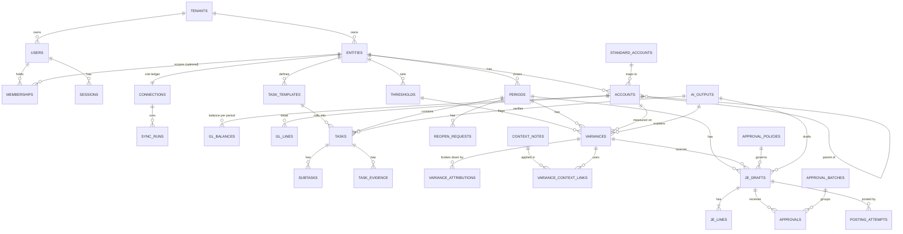

# Database Design: Continuous Close Hub

| | |
|---|---|
| **Status** | Proposed v1.0 (MVP scope) |
| **Date** | 15 Nov 2026 |
| **Engine** | PostgreSQL 16 |
| **Schema file** | [database/schema.sql](database/schema.sql) |
| **Based on** | [PRD.md](PRD.md) v2.0, [TECH-STACK.md](TECH-STACK.md), [ARCHITECTURE.md](ARCHITECTURE.md) §4. This document replaces the table list in ARCHITECTURE §4.2 |

**Why SQL and not Prisma:** the backend is Python with SQLAlchemy and Alembic, so Prisma (a Node.js tool) doesn't fit. The most important protections (row-level security, triggers, grants and `SECURITY DEFINER` functions) are PostgreSQL features. They are clearest as plain SQL. The SQLAlchemy models will mirror this schema, and Alembic migrations will be generated from it.

---

## 1. Design in brief

The database is not just storage: **it enforces the rules that must never break, even if application code has a bug.**

| Principle | How |
|---|---|
| **Customers can't see each other's data** | Every customer-owned table has `tenant_id` and **row-level security**, which is forced even for the table owner. The API sets the tenant once per transaction. Unset means zero rows |
| **No cross-customer references** | Every table has `UNIQUE (tenant_id, id)`, and every foreign key includes `tenant_id`. A row can't point at another customer's row, even by mistake |
| **Money is exact** | `NUMERIC(20,4)` plus a 3-letter currency code. No floating point |
| **Financial history is never lost** | The app's database roles have **no DELETE right** on financial tables. Approvals, comments, thresholds, AI outputs and audit events are **insert-only**, enforced by both grants and triggers |
| **Segregation of duties in the database** | Checks and triggers stop anyone approving their own work: tasks, context notes, journal entries and reopen requests |
| **Tamper-evident audit log** | Each audit event stores a SHA-256 hash that includes the previous event's hash, per customer. Editing any old row breaks the chain |
| **Separate least-privilege roles** | `app_api`, `app_worker`, `app_auth` (sign-in only) and `app_migrator` (owns objects). Only the worker can record ERP posting attempts and write ledger data |

**Size:** 35 tables in 9 schemas, 29 indexes and 14 triggers.

---

## 2. Schemas

| Schema | Purpose |
|---|---|
| `core` | Shared types (money, currency, month), the tenant helper, idempotency keys |
| `auth` | Sessions. Reachable only through sign-in functions |
| `tenancy` | Tenants, entities, users, role memberships |
| `brain` | ERP connections, sync runs, chart of accounts, GL balances and lines, FX rates |
| `close` | Periods, checklist templates and tasks, evidence, comments, reopen requests |
| `flux` | Thresholds, variances, attributions, AI context notes |
| `journals` | Approval policies, JE drafts and lines, approvals, posting attempts |
| `ai` | The AI audit log (every model output) |
| `audit` | The append-only, hash-chained event log |

---

## 3. Tables and key fields

Every table also has `id` (UUID primary key) and `tenant_id`, unless noted otherwise. The full column lists are in [schema.sql](database/schema.sql).

### 3.1 Tenancy and auth

| Table | Key fields | Notes |
|---|---|---|
| `tenancy.tenants` | name, workos_org_id (unique), reporting_currency, status | No `tenant_id`; a tenant can see only its own row |
| `tenancy.entities` | name, erp_type (`netsuite` / `sap`), functional_currency, status | One row per legal entity |
| `tenancy.users` | email (unique per tenant, case-insensitive), workos_user_id, status (`invited` / `active` / `deactivated`) | Users are created by SCIM or invitation, never at sign-in |
| `tenancy.memberships` | user_id, entity_id (NULL = all entities), role, revoked_at | Roles: preparer, reviewer, approver, controller, admin, auditor |
| `auth.sessions` | id_hash (PK: SHA-256 of the cookie), user_id, auth_time, expires_at, revoked_at | The raw session ID is never stored |
| `core.idempotency_keys` | (tenant_id, key) PK, request_hash, response_status, response_body, expires_at | A replayed request returns the stored response |

### 3.2 Brain (ledger data)

| Table | Key fields | Notes |
|---|---|---|
| `brain.connections` | entity_id (unique: one ledger per entity), erp_type, secret_ref, status, last_sync_at | `secret_ref` points to Secrets Manager. The credential itself never enters the database |
| `brain.sync_runs` | connection_id, trigger, status, since_cursor, stats | Supports incremental sync and the freshness display |
| `brain.standard_accounts` | code, name, account_class, parent_id | The group chart that entity accounts map to |
| `brain.accounts` | entity_id, erp_account_code, account_class, statement, parent_account_id, std_account_id | `std_account_id` NULL = unmapped, which blocks the period lock. `parent_account_id` builds the flux tree |
| `brain.gl_balances` | PK (tenant_id, entity_id, account_id, period), amount_functional, amount_reporting | What flux reads. `amount_reporting` stays NULL until an FX rate exists (EC-5) |
| `brain.gl_lines` | account_id, period, erp_line_ref (unique per entity), amount, memo, counterparty_ref, dims | Drill-down and AI citations. `memo` is treated as untrusted text |
| `brain.fx_rates` | period, from_ccy, to_ccy, rate_type (`closing` / `average` / `historical`), rate > 0 | |

### 3.3 Close

| Table | Key fields | Notes |
|---|---|---|
| `close.periods` | entity_id, period (first of month), status (`open` / `locked`), target_close_day, locked_by | Unique per entity per month |
| `close.task_templates` (+ `task_template_dependencies`) | phase, title, due_day_offset, default owner and reviewer, requires_evidence, is_reconciliation | Rolls forward each period |
| `close.tasks` (+ `task_dependencies`) | period_id, owner_id, reviewer_id, status, verified_by_ai, ai_output_id, submitted_by, signed_off_by, version | `version` supports ETag concurrency |
| `close.subtasks` | task_id, title, is_done, ai_drafted, created_by, removed_at | "Delete" is a soft remove |
| `close.task_evidence` | task_id, s3_key, sha256, size_bytes (≤ 100 MB), scan_status | The file lives in S3; malware scan status gates downloads |
| `close.comments` | subject_type, subject_id, author_id, body | Insert-only. Attached to tasks, variances, drafts or context notes |
| `close.reopen_requests` | period_id, reason, requested_by, decided_by, status | At most one pending request per period |

### 3.4 Flux

| Table | Key fields | Notes |
|---|---|---|
| `flux.thresholds` | entity_id, account_class (NULL = default), abs_amount, pct, version, effective_from | Insert-only; a new version replaces the old one |
| `flux.variances` | period_id, account_id (unique per period), prior, current, delta, delta_pct, is_flagged, threshold_id, status, explanation_ai_output_id, input_hash, changed_after_signoff | Precomputed after each sync. `threshold_id` records exactly which rule flagged the line |
| `flux.variance_attributions` | variance_id, child_account_id, amount, share_pct | |
| `flux.context_notes` | scope (`account` / `account_group` / `cross_entity`), entity_id, account_id, std_account_id, text, status, proposed_by, decided_by, review_by, version, supersedes_id | Implements PRD §10.2 |
| `flux.variance_context_links` | variance_id, context_note_id, ai_output_id | Shows which context each explanation used |

### 3.5 Journals

| Table | Key fields | Notes |
|---|---|---|
| `journals.approval_policies` | entity_id, second_approval_above, currency, version | Insert-only, versioned |
| `journals.je_drafts` | period_id, je_type, source_type, source_variance_id, status, created_by_ai, ai_output_id, preparer_id, total_amount, requires_second_approval, version, erp_doc_number | Status: draft → submitted → approved → posting → posted (or rejected / post_failed / withdrawn) |
| `journals.je_lines` | draft_id, line_no, account_id, debit, credit, dims | Exactly one of debit or credit on each line |
| `journals.approval_batches` | period_id, approver_id, entry_count | Groups a batch approval |
| `journals.approvals` | draft_id, draft_version, level (1 or 2), approver_id, decision, batch_id | Insert-only. One row per entry, even inside a batch |
| `journals.posting_attempts` | draft_id, attempt_no, idempotency_key, request_hash, status, erp_doc_number, erp_response | Written only by the worker |

### 3.6 AI and audit

| Table | Key fields | Notes |
|---|---|---|
| `ai.ai_outputs` | kind, outcome, model_id, request_id, prompt_version, input_record_ids, input_hash, output, citations, confidence, inference_region, tokens, latency | Insert-only. The AI audit log from PRD §10 item 2 |
| `audit.events` | id (bigint identity), occurred_at, actor_type (`user` / `ai` / `system`), actor_id, action, subject_type, subject_id, before, after, request_id, prev_hash, hash | Insert-only, hash-chained per tenant |

---

## 4. Relationships

`audit.events` and `close.comments` are attached to records by `(subject_type, subject_id)` rather than by foreign keys, because they can point at several kinds of record. The service layer checks that the subject exists.

---

## 5. Primary and foreign keys

| Rule | Detail |
|---|---|
| Primary keys | `id UUID`, generated by the application as **UUIDv7** (time-ordered, unguessable). The database default `gen_random_uuid()` is only a fallback. Exceptions: `gl_balances` uses a natural key (tenant, entity, account, period); `audit.events` uses a `BIGINT` identity, which gives the chain its order; `auth.sessions` is keyed by the session hash |
| Tenant-safe foreign keys | Every table declares `UNIQUE (tenant_id, id)`, and children reference `(tenant_id, parent_id)`. A cross-tenant reference fails even for a superuser-written row |
| Self-references | `accounts.parent_account_id`, `standard_accounts.parent_id`, `context_notes.supersedes_id`, plus task and template dependencies (no self-loops) |

---

## 6. Constraints

### 6.1 Check constraints

| Area | Constraint |
|---|---|
| Types | `money_amount` = `NUMERIC(20,4)`; `currency_code` matches `^[A-Z]{3}$`; `period_month` is always the 1st of a month |
| Enumerations | Every status, role, type and phase column is limited to its allowed values |
| Tasks | Reviewer ≠ owner; signer ≠ submitter; an AI-verified task must link its AI output; a completed task needs a sign-off or an AI verification; reconciliation templates require evidence |
| Periods | `status = 'locked'` exactly when `locked_at` and `locked_by` are set |
| Variances | `delta = current − prior`; flagged exactly when status ≠ `not_flagged`; signed-off or exception lines record who signed; an exception needs a reason |
| Context notes | Decider ≠ proposer; a decision is recorded exactly when status ≠ `pending`; scope must match which IDs are set |
| Reopen requests | Decider ≠ requester; reason of at least 10 characters; one pending request per period |
| JE drafts | A variance-sourced draft must link its variance; an AI-created draft must link its AI output; a preparer is required after `draft`; `posted` requires a doc number and time |
| JE lines | Debit ≥ 0, credit ≥ 0, and **exactly one** of them is non-zero |
| Approvals | A rejection needs a comment; one decision per (draft, version, level) |
| Posting | A successful attempt must have an ERP doc number; **at most one successful post per draft** (partial unique index) |
| AI outputs | Confidence between 0 and 1; an `ok` outcome must have output |
| Evidence | File size from 1 byte to 100 MB |

### 6.2 Triggers (rules that span rows or tables)

| Trigger | Rule | PRD |
|---|---|---|
| `guard_locked_period` on tasks, variances, JE drafts | No insert, update or delete in a locked period | §10 item 7 |
| `check_draft_on_submit` | A draft needs ≥ 2 lines and must balance before it can be submitted. It also sets `total_amount` | JE-6 |
| `freeze_lines` | Lines can't change once a draft leaves `draft` | JE-6 |
| `check_approval_sod` | The draft must be `submitted`; the approved version must be the current one; the approver ≠ the preparer; level 2 needs level 1 first, from a different person | JE-4 |
| `check_draft_approved` | A draft becomes `approved` only when every required approval exists for its current version | JE-3, JE-4 |
| `chain_event` | Calculates `prev_hash` and `hash` for each audit event, serialised per tenant | ARCH S-6 |
| `forbid_change` on audit events, AI outputs, approvals, comments, thresholds, approval policies | Blocks UPDATE and DELETE, even for the table owner | NFR-Auditability |

### 6.3 Row-level security and grants

| Role | Can do |
|---|---|
| `app_api` | SELECT/INSERT/UPDATE on app tables under RLS; INSERT-only on AI outputs and audit events; **no DELETE** on financial tables; **no** posting attempts or ledger writes; sessions only through the auth functions |
| `app_worker` | Same as `app_api`, plus GL data, sync runs and posting attempts |
| `app_auth` | Owns only the sign-in functions and the sessions table. Bypasses RLS, because it runs before a tenant is known. It can link an invited user on first sign-in, but **can't create users** |
| `app_migrator` | Owns all other objects and runs migrations. Still subject to RLS (`FORCE`) |

---

## 7. Important indexes

Every index starts with `tenant_id`, so row-level security and the queries share the same index prefix.

| Index | Serves |
|---|---|
| `gl_balances` PK (tenant, entity, account, period) | Flux calculation and balance lookups (P-1) |
| `gl_lines (tenant, entity, account, period)` | Drill-down and citations (P-2) |
| `variances (tenant, period, status) WHERE is_flagged` | The flux screen and the period-lock gate |
| `tasks (tenant, period, phase)` | The checklist screen |
| `tasks (tenant, owner) WHERE open` / `(tenant, reviewer) WHERE submitted` | "My tasks" and "my review queue" |
| `je_drafts (tenant, period, status)` | The JE review list and batch approval |
| `posting_attempts (tenant, idempotency_key)` + unique `(tenant, draft) WHERE succeeded` | Resolving uncertain posts; never two successful posts (S-4) |
| `ai_outputs (tenant, kind, input_hash, created_at DESC)` | Reusing an unchanged explanation instead of calling the AI again (P-4) |
| `context_notes (tenant, entity, account) WHERE approved` / `(tenant, review_by) WHERE approved` | Building AI prompts; the expiry review |
| `accounts (tenant, entity) WHERE unmapped` | The period-lock gate and setup screen (US-2) |
| `events (tenant, subject_type, subject_id, id)` / `(tenant, occurred_at)` | Audit trace view (US-22) and period export (US-24) |
| `memberships (tenant, user, entity, role) NULLS NOT DISTINCT WHERE active` (unique) | Permission checks; no duplicate active roles |
| `sessions (user) WHERE active` | Revoking all sessions on deprovisioning |
| `users (tenant, lower(email))` (unique) | Invitation matching on first sign-in |

---

## 8. How the application uses it

1. **Per request:** `BEGIN` → `SET LOCAL app.tenant_id = '<tenant>'` → queries → audit insert → `COMMIT`. Using `SET LOCAL` keeps the tenant from leaking to the next request on a pooled connection.
2. **Sign-in:** the API calls `auth.create_session(...)` from the SSO callback, and `auth.load_session(...)` on every request. Logout calls `auth.revoke_session(...)`, and SCIM deprovisioning calls `auth.revoke_user_sessions(...)`.
3. **Editing a draft:** the app increments `version` on every edit. Approvals record the version they saw, so approving a version that has since changed is rejected.
4. **Idempotency:** each write stores `(tenant, key, request_hash)`. The same key with a different body is rejected.

---

## 9. Verification

The schema was loaded into a temporary **PostgreSQL 16** container and checked with 25 smoke tests, all passing:

| Area | Checks |
|---|---|
| Tenant isolation | Tenant A sees only its own entities and tenant row; can't write a tenant B row; can't reference tenant B's period; sees nothing when no tenant is set |
| Privileges | No DELETE on financial tables; approvals and audit events can't be edited; the API can't record posting attempts or read sessions directly |
| SOD | A task owner can't review their own task; a preparer can't approve their own JE; a stale draft version can't be approved |
| JE integrity | An unbalanced draft can't be submitted; a line can't be both debit and credit; lines freeze after submit; a draft can't be approved without approval rows; a valid approval by a different user works |
| Audit | Event 2's `prev_hash` equals event 1's `hash` |
| Period lock | Editing a task in a locked period is rejected |
| Auth | An invited user is linked on first sign-in; a session loads; an unprovisioned user is refused; a revoked session no longer loads |

These checks will become automated integration tests (pytest + Testcontainers, per TECH-STACK §8).

---

## 10. Later migrations

`database/schema.sql` is migration **0001** of the API (`apps/api/migrations`). Later migrations add the following:

| Migration | Adds |
|---|---|
| 0002 | **Contract columns:** entity region/parent, user title, account `is_group`, connection mode, task description, variance `needs_entry`, context-note decision fields, JE number/label, audit `entity_id` + `summary` (both inside the hash). **v1 schemas:** `accruals`, `recognition`, `consolidation`. **Job queue:** `jobs.jobs`, claimed through `jobs.claim_next()` (role `app_jobs`). |
| 0003 | `DELETE` on `journals.je_lines` so a **draft's** lines can be replaced. The `freeze_lines` trigger still blocks changes once an entry is submitted |

## 11. Not in this schema yet

| Item | When |
|---|---|
| `gl_lines` partitioning by period | When volume needs it (ARCHITECTURE P-2) |
| `changed_after_signoff` / `source_changed` behaviour | The columns exist, but the rules depend on PRD question **Q6** |
| Data retention and archiving policy | To be decided with legal and the auditor |
